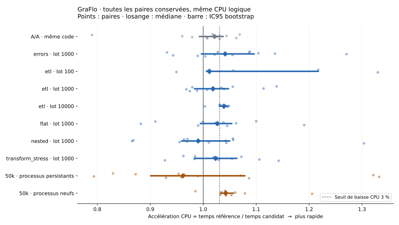

# GraFlo / FalkorDB benchmark evidence

Synthetic workloads measured on 28–29 October 2026, published on 30 October.
This evidence branch is separate from the code PRs. Reports and protocols retain
their original dates, source revisions and historical local-only status; the
[publication manifest](publication-manifest.json) records the subsequent export.

## Casting candidate: performance gate not met

Candidate source: `833ca760e1ae2daacd084d8f1a3ddf84a9b0f022`.
Frozen reference: `12431f62124988ddd12a949841ef55d9c956ace3`.
Python 3.11.13, Linux aarch64, same read-only dependencies, inline casting,
workers pinned to the same logical CPU before imports and thread creation.
The host remained shared; affinity does not reserve a CPU or fix its frequency.

| Confirmation | Pairs | Reduction inferred from median CPU speedup | Speedup 95% CI |
| --- | ---: | ---: | ---: |
| 50,000 documents, persistent processes | 12 | -3.98% | 0.9010–1.0786x |
| 50,000 documents, fresh processes per pair | 12 | 4.09% | 1.0340–1.0570x |
| A/A, identical reference code, 5,000 documents | 12 | 2.10% apparent | 0.9931–1.0376x |

The global predeclared gate is **not met**. The fresh-process result is promising;
the persistent-process result does not corroborate it. Four fresh-server pairs
of 100,000 CSV/JSONL documents show a 2.46% wall-time reduction, an exploratory
result with too few pairs to establish a small general gain. No speedup is
claimed for arbitrary workloads, other Python versions or other machines.

CPU speedup is reference time / candidate time. Reported reduction is
`100 * (1 - 1 / median(paired speedups))`; with an even number of pairs this
can differ slightly from the median of individual reductions. Bootstrap uses
10,000 resamples of pairs. Persistent-process intervals are conditional on those
processes; secondary workload intervals have no multiple-comparison correction.

- [Full report](casting-optimization-20261029/rapport.html),
  [acceptance result](casting-optimization-20261029/acceptance-final.json),
  [protocol and source identities](casting-optimization-20261029/paired-protocol-final.json),
  [fresh-process protocol](casting-optimization-20261029/fresh-process-confirmation-before-run.txt).
- [Matrix: all raw pairs](casting-optimization-20261029/paired-cast-final-cpu2.jsonl),
  [persistent confirmation](casting-optimization-20261029/paired-cast-confirmation-cpu2.jsonl),
  [fresh-process confirmation](casting-optimization-20261029/paired-cast-confirmation-fresh-cpu2.jsonl),
  [A/A](casting-optimization-20261029/paired-cast-final-cpu2-aa.jsonl).
- [Full file-ETL verification](casting-optimization-20261029/e2e-summary.json):
  800,000 Item nodes, 8,000 Category nodes and 800,000 edges independently read
  and checked, including exact scalar types and float bits. Raw typed output
  archives are retained for every run. Graph hashes match across all eight runs.
- [Two callback counterexamples and rejected variants](casting-optimization-20261029/experiments/)
  are retained. The final generated comparison covers
  [3,000 examples](casting-optimization-20261029/differential-fusion-hardened.json).
  Random generation did not discover every adversarial case; explicit tests
  now cover the two callback defects found during development.
- [Diagnostic differences](casting-optimization-20261029/diagnostic-final-comparison.json)
  and [index-listing order differences](casting-optimization-20261029/index-listing-order-audit.json)
  are explicit. Raw graph values were not normalized. Raw traceback locations
  necessarily differ with helper names, line numbers and checkout paths.
- [Reproduction](casting-optimization-20261029/reproduce.txt) and
  [environment](casting-optimization-20261029/environment-final.json).

## FalkorDB C / Rust compatibility and write diagnosis

- [PR #400 group-preflight follow-up](pr400-fix-20261030/README.md):
  the later-group overflow regression fails before the fix and passes after it;
  31 parameter tests, 194 live tests on each engine and 5,221 offline tests pass.
  No query is sent for the rejected grouped batch.

- [Compatibility validation](falkordb-validation/README.txt),
  [original test metadata](falkordb-validation/validation.json).
  These measurements identify their original pre-rebase source revision.
  Publication-day checks after rebasing are under `publication-20261030/`.
- [Repeated SDK benchmarks](falkordb-benchmarks-20261029/rapport.html),
  [raw summary](falkordb-benchmarks-20261029/summary.json),
  [protocol](falkordb-benchmarks-20261029/protocol.json).
- [Native MERGE diagnosis](falkordb-investigation-20261029/README.txt),
  [upstream identity](falkordb-investigation-20261029/upstream.json),
  [raw diagnosis](falkordb-investigation-20261029/summary.json).
  The large-batch collapse was reproduced outside GraFlo. The official edge
  image after FalkorDB/FalkorDB#3067 fixes that reproducer; this is not full
  compatibility validation of a new stable release or an upgrade test.
- [Full ETL and concurrent-reader campaign](falkordb-etl-benchmarks-20261029/rapport.html),
  [protocol](falkordb-etl-benchmarks-20261029/protocol.json),
  [raw summary](falkordb-etl-benchmarks-20261029/summary.json).
  Nine trials, 1.8 million source records, 41,383 checked reads. Achieved reader
  load varies; sampled memory peaks are not guaranteed absolute phase peaks.
  The initial 59–75% casting observation is wall duration, not exclusive CPU
  attribution. Failed setup/control-file trials remain in the excluded folder.

## Reproducing and interpreting the archive

All exported observations are byte-for-byte copies of the local originals;
[publication-manifest.json](publication-manifest.json) lists their SHA-256 hashes.
Deterministic CSV/JSONL input files and Python caches are omitted, with original
hashes recorded. Generate the input files using the included `scenario.py` at
2,000 and 100,000 documents; preserve the recorded hashes. Local absolute paths
in historical scripts describe the actual setup; adapt mount source paths when
recreating it elsewhere. Source paths inside containers remain `/repo`,
`/candidate`, `/scenario` and `/evidence` as specified by each protocol.

Reports are HTML files that can be downloaded and opened locally. The Markdown
tables above and SVG are directly viewable on GitHub. Installed editable package
metadata says 1.24.0 while checked imports use 1.24.1 source for casting; the
dependency lock differs only in the package version string and the same venv
serves both sides. All chronology, caveats, outliers and counterexamples are
retained. Publication does not change the negative casting acceptance verdict.
